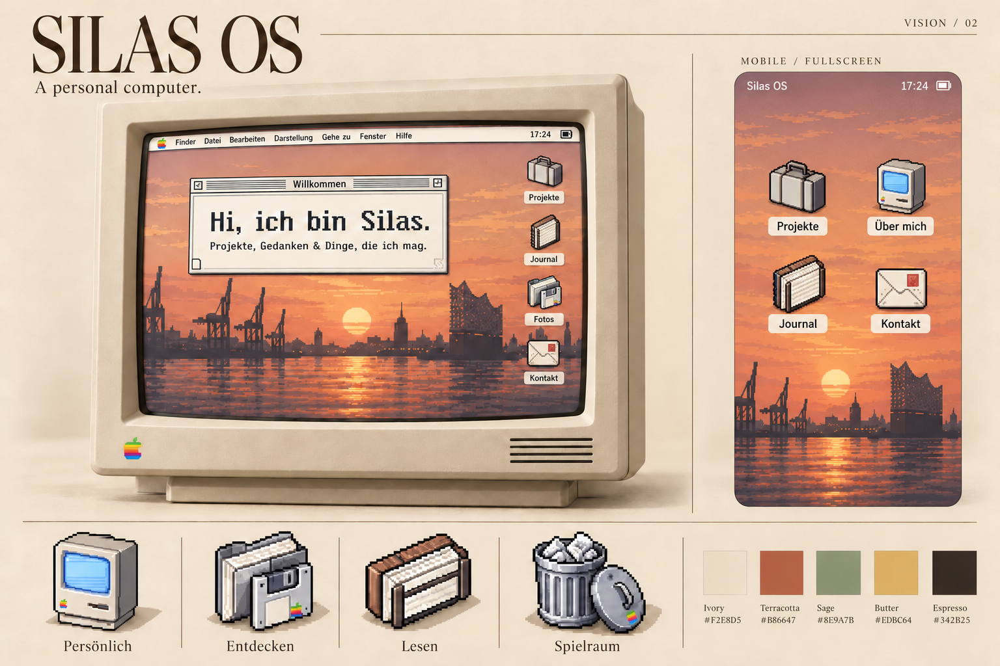

# Silas OS — Vision 02

Stand: 24. Oktober 2026. Planungsstand nach Nutzerfeedback. Der Mac-Look ist bestätigt; ein Three.js-Modell wird als technische Umsetzung vorgeschlagen. Noch keine Implementierung.

## Leitidee

Eine persönliche Website als warmer, bewohnter Computer. Am Desktop sitzt man visuell vor einem Mac; auf dem Handy füllt dessen fiktives mobiles Betriebssystem aus dem Jahr 1990 die verfügbare Bildschirmfläche. Beide teilen Icons, Farben, Inhalte und Persönlichkeit.

Die OS-Anmutung soll vollständig und stimmig wirken. Die Funktionen konzentrieren sich auf das Erkunden und Lesen der persönlichen Website.

## Bestätigte Entscheidungen

- Zielgruppe: Kunden, Community und Menschen, die sich für Silas' Arbeit und Person interessieren.
- Der plastische cremefarbene Mac aus Vision 01 gefällt dem Nutzer und bleibt die visuelle Referenz.
- Desktop: keine untere Leiste und kein Dock. Apps liegen als Icons auf dem Desktop; die klassische Menüleiste bleibt oben.
- Mobil: bildschirmfüllende Oberfläche ohne zusätzlich gezeichnetes Telefongehäuse. Der Retro-Charakter kommt aus Icons, Farben, Typografie und Bedienelementen.
- Three.js für das Desktop-Gehäuse ist die gewünschte technische Richtung; die genaue visuelle Übereinstimmung wird an einem Prototyp geprüft.
- Das LinkedIn-Cover `Hamburg Silouette.png` im Projektordner ist die verbindliche Referenz für Hintergrund und Pixelstil der gesamten Website: detaillierte Hamburger Hafenszene, honiggoldenes Abendlicht, apricotfarbene Wolken, schiefergrauer Himmel und fein abgestufte Pixelreflexionen. Diese Referenz ersetzt die freiere orangefarbene Panorama-Interpretation der ersten Boards.
- Die nächste Darstellung besteht aus zwei separaten reinen Website-Ansichten (Desktop und Mobil), ohne externe Überschrift, Farbpalette, Icon-Studien oder sonstige Board-Beschriftung. Die klassische Menüleiste innerhalb der Oberfläche bleibt Teil des OS-Designs.

## Visuelle Richtung

- Cremefarbenes Gehäuse mit sichtbarem Rahmen, dezenter Tiefe und Luft zum Browserrand. Der Desktop belegt die Bildschirmfläche innerhalb dieses Rahmens.
- Warme Papierflächen, Terrakotta, Salbei, Buttergelb und dunkles Espresso für Text und Konturen.
- Hamburg-Panorama und fein detaillierter Pixelstil nach dem vom Nutzer ausgewählten LinkedIn-Cover `Hamburg Silouette.png`. Dessen weiße Außenränder gehören nicht zum Website-Hintergrund.
- Klassische Mac-Fenster mit gestreiften Titelleisten, klaren Bedienelementen und gut lesbarem Inhalt.
- Plastische Pixelobjekte nach den vier Bildreferenzen: gemeinsame Perspektive, Lichtquelle, Kontur und Pixelraster; transparente Hintergründe.
- Pixeltypografie als Akzent in der Oberfläche. Längere Texte bekommen eine ruhige, gut lesbare Schrift und bleiben echter HTML-Text.
- Auf dem Handy eine bildschirmfüllende Retro-Oberfläche ohne äußeres Gehäuse. Safe Areas und mobile Browserleisten werden berücksichtigt.

### Erste Farbpalette

| Rolle | Farbe |
| --- | --- |
| Papier / Gehäuse | `#F2E8D5` |
| Primärer warmer Akzent | `#B86647` |
| Ruhiger Gegenpol | `#8E9A7B` |
| Kleiner Lichtakzent | `#E0BC64` |
| Schrift / Kontur | `#342B25` |

## Inhalte und Navigation

Als Startpunkt sechs klar benannte Apps: Über mich, Projekte, Journal, Fotos, Kontakt und ein kleiner persönlicher Spielraum. Für Kunden stehen Arbeitsbeispiele und Kontakt schnell bereit; Community und Interessierte können über Journal, Fotos und persönliche Inhalte weiter erkunden. Die ersten klar sichtbaren Einstiege sind Projekte, Über mich und Kontakt.

Das Willkommensfenster zeigt eine kurze echte Vorstellung und einen direkten Weg zu Projekten und Kontakt. Die vorhandenen Platzhalter sind keine Biografie und werden später gemeinsam ersetzt.

Icons erhalten verständliche Bedeutungen: Computer für Über mich, Archiv für Projekte, Notizbuch für Journal, Fotos für die Galerie und Briefumschlag für Kontakt. Der Papierkorb kann ein freiwilliges Easter Egg werden.

## Verhalten

Desktop: Ein Klick auf ein Desktop-Icon öffnet eine App. Fenster lassen sich fokussieren, verschieben und schließen; sie bleiben innerhalb des dargestellten Bildschirms. Mehrere Fenster dürfen gleichzeitig offen sein. Ein sinnvoll begrenztes Vergrößern kommt bei längeren Inhalten hinzu. Es gibt kein Dock und keine untere App-Leiste.

Mobil: Dieselben App-Icons öffnen jeweils eine gut lesbare Ansicht. Ein sichtbarer Zurück-/Home-Weg in der oberen App-Leiste und die Browser-Zurückfunktion führen zurück. Die Oberfläche füllt den verfügbaren Browserviewport; sie verlangt keinen automatischen Wechsel in den Browser-Fullscreen-Modus. Es gibt keine winzigen verschiebbaren Fenster und kein zusätzliches Gerätegehäuse auf dem Handy.

Gemeinsam: Links zu einzelnen Inhalten bleiben teilbar. Tastatur, sichtbarer Fokus, ausreichende Touchflächen, Zoom und reduzierte Bewegung sind Teil der Gestaltung. Inhalte bleiben auch ohne JavaScript zugänglich. Kurze Zustandsanimationen unterstützen Öffnen und Schließen; eine Boot-Sequenz darf den Einstieg nicht verzögern.

## Astro und KISS

Die bestehende Basis passt: Astro ohne zusätzliche UI-Framework-Abhängigkeit, Inhaltsdateien in Markdown, wiederverwendbare Fenster und ein Vanilla-JavaScript-Fenstermanager.

1. Ein Inhaltsmodell und eine App-Registry für beide Bildschirmgrößen.
2. Gemeinsame Komponenten für Bildschirm, App-Icon und Fenster; CSS übernimmt die Anordnung. Eine Desktop-Komponente ergänzt das 3D-Gehäuse.
3. Statische Astro-Seiten stellen die Inhalte bereit. Kleine JavaScript-Module ergänzen Fensterinteraktion und Navigation.
4. Positionen und Grenzen werden relativ zum dargestellten Bildschirm berechnet. Der aktuelle Fenstermanager verwendet dafür noch Browsermaße und muss bei der Umsetzung angepasst werden.
5. Das Desktop-Gehäuse wird in Three.js dargestellt. Titelleisten, Texte, Fenster und Bedienelemente bleiben echtes HTML/CSS. Generierte Bilder dienen als Wallpaper und Icon-Assets, nicht als komplette Oberfläche.
6. Für das neue Retro-Konzept werden die vorhandenen Glas-/Linsenfilter durch einfachere Flächen ersetzt. Bewegungen verwenden möglichst Transform und Opacity; große Medien werden bedarfsgerecht geladen.

Performance-Ziele werden bei der Umsetzung auf echten Ansichten geprüft: LCP höchstens 2,5 s, INP höchstens 200 ms, CLS höchstens 0,1. Das sind Zielwerte, keine bereits gemessenen Ergebnisse. Zusätzlich prüfen wir die Fensterbewegung auf einem schwächeren Gerät und bei reduzierter Bewegung.

### Three.js: Gehäuse und Website zusammenbringen

Das Modell bekommt die Proportionen, den warmen Kunststoff, die abgerundeten Kanten, Lüftungsschlitze, den Fuß und die weiche Beleuchtung des Boards. Das generierte Bild dient als Referenz; es ist noch kein 3D-Asset. Form, Material und Licht werden separat aufgebaut und visuell abgeglichen. Ein exakt identisches Ergebnis wird vor diesem Abgleich nicht behauptet.

Die Standardansicht nutzt eine feste, nahezu frontale Kamera. Die HTML-Oberfläche wird passgenau über der Bildschirmöffnung positioniert. Die komplette Website muss dadurch nicht als WebGL-Textur gerendert werden; Textauswahl, Links, Formulare, Tastatur und Browserzoom bleiben normale Web-Funktionen. Freie Rotation gehört nicht zum ersten Prototyp, weil sie die Lesbarkeit und die einfache Ausrichtung der Bildschirmoberfläche erschweren würde.

Three.js wird nur für die Desktop-Ansicht dynamisch geladen. Die mobile Erstanzeige lädt keine 3D-Engine; ein späterer Wechsel zwischen Layouts muss Initialisierung und Freigabe der GPU-Ressourcen berücksichtigen. Bei nicht verfügbarem WebGL bleibt eine statische Gehäuseansicht mit derselben HTML-Oberfläche benutzbar.

Die Szene rendert beim Laden, bei Größenänderungen und bei tatsächlichen Änderungen an Kamera oder Licht. Im Ruhezustand ist keine dauerhafte Animationsschleife nötig. Eine kurze optionale Eingangsbewegung darf keinen Inhalt blockieren. Aufwendiges Echtzeit-Postprocessing wird für den ersten Prototyp nicht eingeplant; weiches Licht und ein einfacher Bodenschatten reichen als Ausgangspunkt.

Ein erster Prototyp kann das Gehäuse aus wenigen parametrischen Geometrien aufbauen. Falls die Referenz damit nicht überzeugend erreicht wird, folgt ein eigens ausgearbeitetes, optimiertes GLB-Modell. Eine zusätzliche React-Schicht wird dafür nicht benötigt.

## Reihenfolge der Umsetzung

1. Vision 02 festhalten: bestätigter Mac-Look, Desktop ohne Dock, mobile Oberfläche bildschirmfüllend, Zielgruppe Kunden und Community.
2. Einen kleinen Prototyp mit Three.js-Gehäuse, echter HTML-Bildschirmfläche, Über-mich-Fenster und Projekte-App bauen. Mobile zeigt dieselben Inhalte ohne Gehäuse und ohne 3D-Engine. Form, Lesefläche und Ladeverhalten gemeinsam prüfen.
3. Ein Referenz-Icon finalisieren, dann daraus die übrige Iconfamilie mit dem Bildtool ableiten; kleine Darstellungen visuell überprüfen.
4. Echte Inhalte, App-Navigation, direkte URLs und Medien ergänzen.
5. Tastatur, Touch, Browsernavigation, Bildgrößen und Performance überprüfen; abschließend Bewegungen und Details verfeinern.

## Stellschrauben für die nächste Runde

- Gehäuse: Proportionen, Material und Licht möglichst nah am bestätigten Mac aus dem Board ausarbeiten.
- Hintergrund und Pixelstil: an das ausgewählte LinkedIn-Cover angleichen und die Bildkomposition für Desktop und Mobil separat anpassen, ohne die Gebäude zu verzerren.
- Icons: möglichst nah an den Referenzen oder stärker persönliche Gegenstände?
- Informationsgewicht: Projekte, Über mich und Kontakt als klare erste Wege; Journal, Fotos und Spielraum vertiefen die persönliche Welt.

## Quellen und Abgrenzung

Die vom Nutzer erwähnte Referenz „Posthoc“ wurde vorläufig als PostHog verstanden. Inspiration ist das Fensterprinzip, nicht dessen vollständige technische Architektur: [PostHog site architecture](https://github.com/PostHog/posthog.com/blob/master/contents/handbook/engineering/posthog-com/technical-architecture.md).

Für die technische Planung konsultiert: [Astro-Komponenten](https://docs.astro.build/en/basics/astro-components/), [Content Collections](https://docs.astro.build/en/guides/content-collections/), [Routing](https://docs.astro.build/en/guides/routing/) und [Styling](https://docs.astro.build/en/guides/styling/).

Three.js-Grundlagen: [Rendern nur bei Änderungen](https://threejs.org/manual/pages/rendering-on-demand.html), [GLB/glTF-Modelle](https://threejs.org/manual/pages/loading-3d-models.html). Der eingebaute [CSS3DRenderer](https://threejs.org/docs/pages/CSS3DRenderer.html) dokumentiert eine Beschränkung auf 100 % Browser-/Displayzoom und ist deshalb nicht die geplante Basis für die bedienbare Bildschirmoberfläche.

## Bildgenerierung

Das Vision Board wurde mit dem eingebauten Bildtool erstellt. Die vier Nutzerbilder wurden ausschließlich als Stilreferenzen eingesetzt. Das Board ist eine visuelle Richtungsstudie; produktionsfertige Einzelicons und Geräteoberflächen werden separat ausgearbeitet.

Prompt-Kern: Editorial vision board for “SILAS OS — A personal computer.” Warm ivory Macintosh-inspired physical monitor with clear surrounding space, classic striped window chrome, terracotta Hamburg sunset wallpaper; matching fictional cream iPhone from 1990 with identical app icons; sculptural isometric pixel icons guided by the supplied references; ivory, terracotta, sage, butter and espresso palette; quiet, tactile and inviting.

Korrekturprompt: Preserve the complete board and replace Kontakt trash icons with cream pixel envelopes and Journal computer icons with brown-and-ivory notebooks; preserve the independent trash-can study.

Vision 02 wurde mit demselben eingebauten Bildtool als Bearbeitung von Vision 01 erstellt. Sie entfernt das Desktop-Dock und ersetzt das dargestellte Telefongehäuse durch eine bildschirmfüllende mobile Oberfläche. Der vollständige Bearbeitungsprompt steht in [vision-02-prompt.txt](./vision-02-prompt.txt). Vision 01 bleibt als frühere Referenz erhalten.
